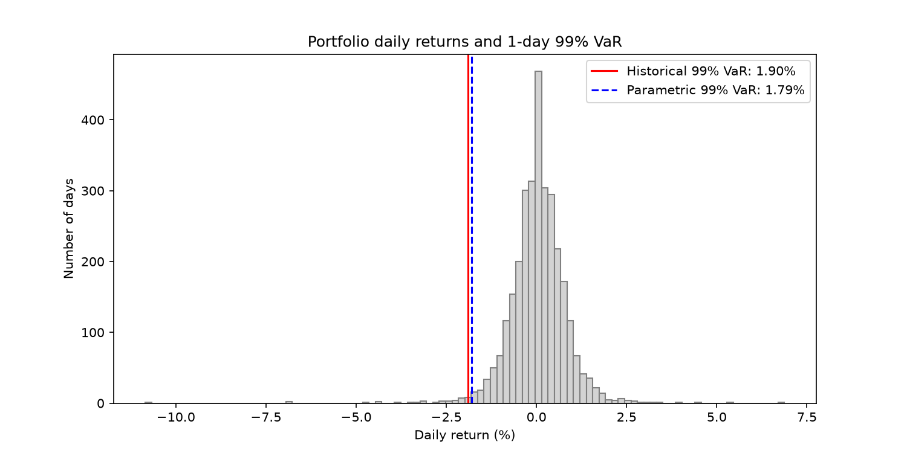
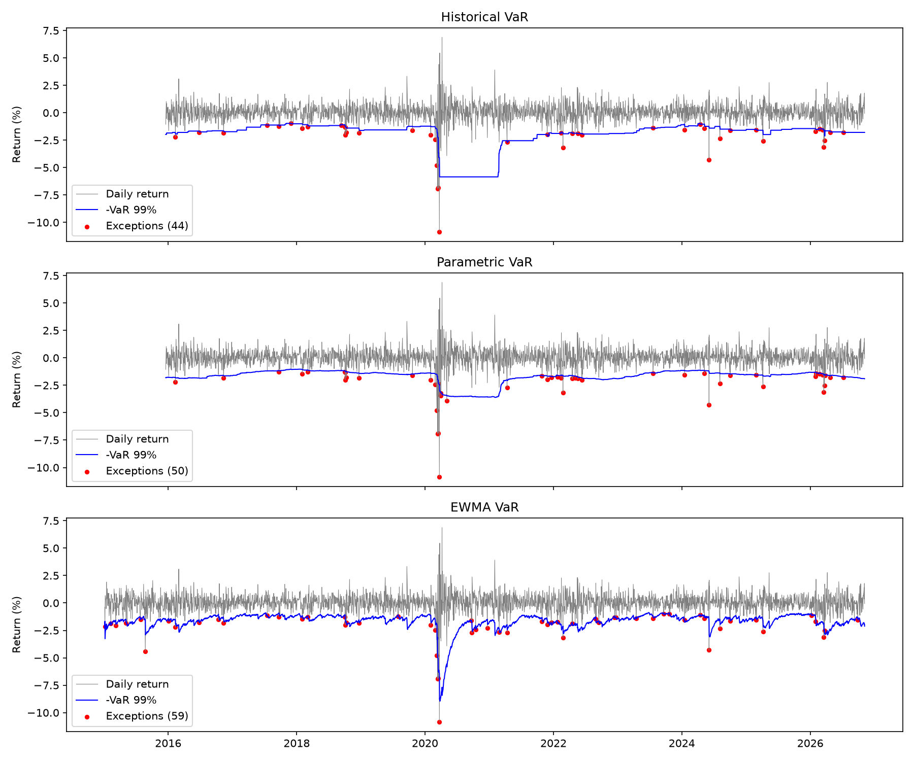
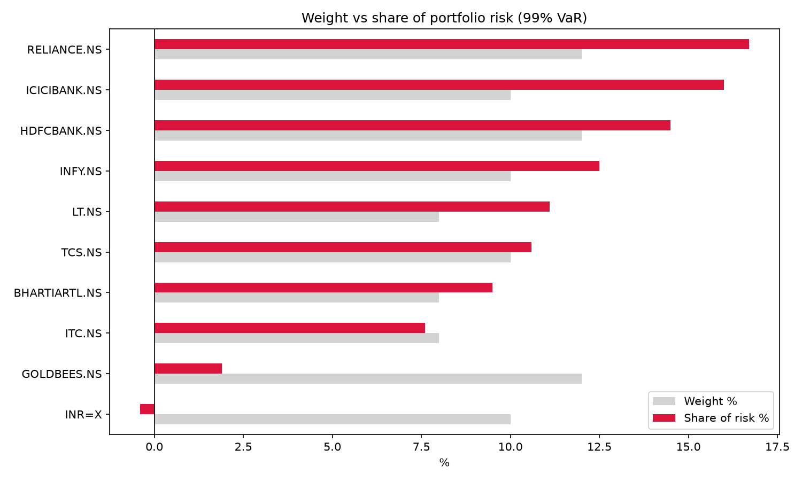

# Value at Risk Engine for an Indian Multi-Asset Portfolio

A Python project that measures, tests and explains the market risk of a Rs 1 crore portfolio of
8 NSE large-cap stocks, a gold ETF and US dollars, using 11 years of daily data (2015–2026).

It compares six ways of calculating Value at Risk (VaR), adds Expected Shortfall, backtests the
models the way regulators do, breaks the risk down by asset, stress-tests real Indian market
crises and wraps everything in an interactive Streamlit dashboard.



## Key results

| Measure (1-day, Rs 1 crore) | Result |
|---|---|
| Historical VaR 99% | **Rs 1.90 lakh** (1.90%) |
| Parametric VaR 99% | Rs 1.79 lakh (1.79%) |
| Monte Carlo (Student-t) VaR 99% | Rs 2.03 lakh (2.03%) |
| Expected Shortfall 97.5% (Student-t) | Rs 2.14 lakh (2.14%) |
| 10-day historical VaR 99% | Rs 6.02 lakh |
| Diversification benefit | **43.8%** less risk (Rs 3.26 lakh → Rs 1.83 lakh) |
| Worst day (23 Mar 2020) | −10.85%, **5.7× the 1-day VaR** |

## Findings

1. **Fat tails.** Parametric (normal) VaR is higher than historical VaR at 95% (1.25% vs 1.10%)
   but lower at 99% (1.79% vs 1.90%). Real returns have more calm days and more extreme days than a
   bell curve, so normal models underestimate extreme risk.
2. **No model passes backtesting.** Historical, parametric and EWMA VaR all breached their 99% VaR on
   1.55–1.91% of days (target: 1%), failed the Kupiec test and landed in the Basel Yellow zone.
3. **The ghost effect.** Historical VaR stayed high for exactly one year after the March 2020 crash,
   then dropped overnight when the crash days left the 250-day window.
4. **EWMA reacts fastest** to new volatility but breaches most often overall.
5. **Concentration.** The 8 stocks are 78% of the capital but about 98% of the risk. HDFC Bank and
   ICICI Bank are 22% of the capital but about 30% of the risk.
6. **Diversifiers and hedges.** Gold is 12% of the capital but 1.9% of the risk. USD has a negative
   risk contribution (−0.4%): it lowers total risk.
7. **Crisis risk.** 4 of the 5 worst days in 11 years fell in March 2020. The worst single day lost
   more than the 10-day VaR.

| Backtest (1-day 99% VaR) | Exceptions | Expected | Rate | Kupiec | Last 250 days |
|---|---|---|---|---|---|
| Historical | 44 | 28 | 1.55% | Fail | 7 (Yellow) |
| Parametric | 50 | 28 | 1.76% | Fail | 9 (Yellow) |
| EWMA | 59 | 31 | 1.91% | Fail | 5 (Yellow) |




## Portfolio

| Asset | Weight | | Asset | Weight |
|---|---|---|---|---|
| Reliance Industries | 12% | | ITC | 8% |
| HDFC Bank | 12% | | Larsen & Toubro | 8% |
| ICICI Bank | 10% | | Bharti Airtel | 8% |
| Infosys | 10% | | Gold ETF (GOLDBEES) | 12% |
| TCS | 10% | | US Dollar (USD/INR) | 10% |

## Methods

- **VaR:** historical simulation, parametric (variance-covariance), EWMA (RiskMetrics, λ = 0.94),
  Monte Carlo with normal and Student-t (df = 4) shocks, at 95% and 99%, 1-day and 10-day
- **Expected Shortfall** at 97.5% (Basel FRTB standard)
- **Backtesting:** rolling 250-day window, Kupiec proportion-of-failures test, Basel traffic light
- **Risk decomposition:** marginal, component and standalone VaR; diversification benefit
- **Stress testing:** demonetisation (2016), IL&FS (2018), COVID (2020), Russia–Ukraine (2022),
  election result day (2024), plus five hypothetical shocks
- **Data quality:** days where any asset moved more than 20% are flagged and removed (bad prices)

## Project structure

```
VaR/
├── src/
│   ├── config.py               portfolio, weights and risk settings
│   ├── data_loader.py          Step 1: download prices, clean data, calculate returns
│   ├── var_basic.py            Step 2: historical and parametric VaR
│   ├── var_advanced.py         Step 3: Expected Shortfall and Monte Carlo VaR
│   ├── backtest.py             Step 4: backtesting and EWMA VaR
│   ├── risk_decomposition.py   Step 5: risk contribution by asset
│   ├── stress_test.py          Step 6: historical and hypothetical stress tests
│   └── app.py                  Step 7: Streamlit dashboard
├── outputs/                    result tables (.csv) and charts (.png)
├── requirements.txt
└── README.md
```

## How to run

```bash
pip install -r requirements.txt

python src/data_loader.py          # downloads data into data/
python src/var_basic.py
python src/var_advanced.py
python src/backtest.py
python src/risk_decomposition.py
python src/stress_test.py

python -m streamlit run src/app.py # interactive dashboard at http://localhost:8501
```

Run every command from the project folder. Each chart opens in a window; close it to continue.

## Tech stack

Python · pandas · NumPy · SciPy · Matplotlib · Streamlit · yfinance (Yahoo Finance data)

## Limitations and next steps

- Weights are assumed to be rebalanced daily; transaction costs are ignored.
- Next: Filtered Historical Simulation (a model that can pass the backtest), the Christoffersen
  independence test, GARCH volatility and a bond ETF as a third asset class.

---
*For educational purposes only. Not investment advice.*
